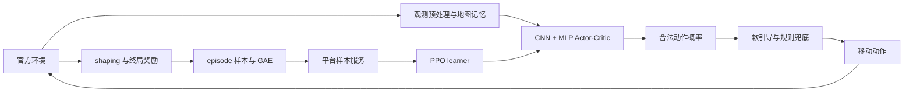

# 腾讯开悟 D02 智能清扫 PPO

[English](README_EN.md) | [架构](docs/architecture.md) | [PPO 实现](docs/ppo.md) | [实验分析](docs/experiments.md)

这是参加 **2026 腾讯开悟人工智能全球公开赛 D02 初赛**的智能清扫机器人工程，保留真实参赛 PPO、CNN + MLP 网络、观测记忆、奖励函数与规则辅助决策。研究对象是局部可见栅格环境中的清扫、探索与电量管理，属于离散机器人导航决策。

**本仓库不提供任何训练模型权重或模型下载链接。完整训练与推理流程未在独立开源环境中验证；部分功能依赖腾讯开悟官方 SDK 与服务。最终提交模型、官方成绩和排名均为 UNKNOWN。**

## 比赛背景

单个学习机器人在局部可见地图中清扫污渍、避让官方 NPC，并在电量耗尽前到达充电桩。清扫、耗电、补电、碰撞、终止与评分由比赛环境提供。[官方赛道页面](https://tencentarena.com/aiarena/zh/match/open-competition-2026/open-competition-2026-2)介绍任务背景，不是本项目成绩证明。

当前保存工程使用 10 张随机地图、4 个 NPC、3 个充电桩、150 最大电量、1000 最大步数。`robot_count=4` 指官方 NPC 数量，不是 4 个 PPO Agent。这份保存配置不能认定为最终参赛配置。

## 项目架构



| 技术 | 实际源码 / 函数 | 作用 |
|---|---|---|
| 观测与状态 | [agent.py](agent_ppo/agent.py) / `observation_process` | 更新地图、访问、轨迹与回充状态，构造 4277D 输入 |
| Actor-Critic | [model.py](agent_ppo/model/model.py) / `Model.forward` | 输出 8 个动作 logits 和 1 个 value |
| 混合决策 | [agent.py](agent_ppo/agent.py) / `predict`、`exploit` | mask、概率引导、采样/贪心、规则调整 |
| 奖励 | [preprocessor.py](agent_ppo/feature/preprocessor.py) / `reward_process` | 门控的清扫、探索、重复与电量 shaping |
| 优势计算 | [definition.py](agent_ppo/feature/definition.py) / `_calc_gae` | 逆序计算 GAE 与 value target |
| PPO 更新 | [algorithm.py](agent_ppo/algorithm/algorithm.py) / `_compute_loss`、`learn` | clipped surrogate、value loss、entropy、一次梯度更新 |
| 采样工作流 | [train_workflow.py](agent_ppo/workflow/train_workflow.py) / `workflow` | 环境交互、终局奖励、GAE 与平台样本发送 |

详见 [架构](docs/architecture.md)与[训练数据流](docs/training.md)。

## PPO 与 Actor-Critic 网络

实际实现为离散动作 Clipped PPO：合法动作 masked softmax、batch advantage 标准化、裁剪 value loss、entropy bonus 与梯度裁剪。`Algorithm.learn` 每次调用只做一次优化，没有本地多 epoch 循环；平台完整样本调度未恢复。

GAE 使用 `delta = reward + gamma * next_value - value`，逆序递推 `advantage = delta + gamma * lambda * next_advantage`，`reward_sum = advantage + value`。函数不读取 `done`；workflow 将 episode 尾帧 `next_value` 置零。

网络保留 73D legacy MLP（73→128→64），加入局部 12 通道和全局 14 通道 CNN（Conv16→Conv32→Flatten→64）、32D scalar MLP、融合分支，以及相加的 Actor/Critic delta heads。Critic 另有三个 gated phase value heads。总参数 678753，无 RNN；记忆由 Agent 显式维护。phase 头命名不等于得到对应阶段的监督保证。[PPO 技术文档](docs/ppo.md)对照层结构和损失公式。

## Observation 与 Action

`4277 = 73 + 588 + 3584 + 32`：

| 分段 | 信息 |
|---|---|
| 73D base | 49 个局部格、16 个状态、8 个合法动作 |
| 588D local | 7×7×12，HWC 局部地图/访问/轨迹记忆 |
| 3584D global | 14×16×16，CHW 累积地图记忆 |
| 32D scalar | 电量、重复、停滞、路线、NPC 与阶段状态 |

全局记忆来自逐步观测，不是开局全图真值。动作 ID 0..7 的 `(dx,dz)` 为 `(1,0),(1,-1),(0,-1),(-1,-1),(-1,0),(-1,1),(0,1),(1,1)`。没有独立充电或停止动作。详见 [观测与动作](docs/observation_action.md)。

## 奖励与混合决策

训练 shaping reward、环境 reward、比赛 `total_score` 是不同量。当前奖励包含每清扫格 +0.16、发生清扫 +0.045、每步 -0.002、新格 +0.008，以及重复、循环、停滞、电量风险、回充进展、NPC 与终局效率项。是否生效取决于完整条件，不是每步全部相加。[奖励文档](docs/reward.md)保留门控和未证明的收益。

网络概率会与手工反重复、已知污渍、frontier 和充电路线概率混合，动作还可能被规则改写。BFS、NPC 避让与卡住恢复属于规则能力。基础 guide 为 0.10，压力设置为 0.22/0.30，另有 score soft bias。

当前 `USE_GUIDED_BEHAVIOR_PROB=False` 保存原 PPO 概率，而实际行为可能已改变。这是保留的分布一致性问题，不能宣称严格 on-policy 已验证。硬接管率不涵盖全部软引导。[混合决策文档](docs/hybrid_decision.md)明确网络、规则和环境的能力边界。

## 保存的训练配置

| 参数 | 当前保存值 |
|---|---|
| gamma / lambda | 0.995 / 0.97 |
| Adam lr / eps / betas | 3e-5 / 1e-8 / (0.9, 0.999) |
| policy / value clip | 0.10 |
| value 系数 | 0.7 |
| entropy beta | 0.008→0.0015，150000 次 learner 调用 |
| gradient norm clip | 0.5 |
| 平台 buffer / batch | 10000 / 2048，Uniform、FIFO、MinSize |
| 环境 | battery 150、3 桩、1000 步、4 NPC、10 图随机 |

配置来源：[conf.py](agent_ppo/conf/conf.py)、[环境 TOML](agent_ppo/conf/train_env_conf.toml)、[平台 TOML](conf/configure_app.toml)。历史 `preload_model=true / 73189` 与 `latest` 设置原样保留，但对应权重不分发；因此入口不能直接使用本仓库运行。它们也不证明最终提交模型。`train_test.py` 是依赖官方运行器的原入口。

## 工程问题与实验结果

实际问题包括地图轴/斜角/blocked TTL、清扫重复与回充路线重复的区分、软引导与硬接管节流、网络结构演进、低资源回充失败及 KL/clip 监控。17 组历史尝试保留成功反馈、回退和失败诊断，区分 VERIFIED、USER_CONFIRMED、UNVERIFIED；缺少原始证据的历史数字不会作为已证成绩。

以下是**持续训练窗口**，不是冻结模型的官方评估。初始化后参数会继续更新。

| 窗口 | 初始化 ID | 电量 / 桩 | 最大步数 / NPC / 地图 | 局数 | 平均 total_score |
|---|---|---|---|---|---|
| W10，4/19 | 39171 | 200 / 4 | 1000 / 4 / 10 图随机 | 53 | 755.830 |
| W11，4/19 | 39171 | 200 / 4 | 1000 / 4 / 10 图随机 | 40 | 701.300 |
| W12，4/19 | 39171 | 200 / 4 | 1000 / 4 / 10 图随机 | 82 | 772.659 |
| W27，4/27 | 73189 | 150 / 3 | 1000 / 4 / 10 图随机 | 33 | 354.939 |

W27 有 18 局 `FAIL_BATTERY`、7 局 `FAIL_BATTERY_LOW_CLEAN`，不支持“低电量失败已解决”。不同资源、代码、奖励与持续更新使 39171/73189 无法公平排名；自定义 `WIN` 不是比赛获胜。公开 [208 条终局记录](experiments/episodes.jsonl)、[79 条 learner 记录](experiments/learner_metrics.jsonl)与[聚合结果](experiments/window_metrics.json)，保留来源行号，去掉私人日志和运行元数据。详见[实验分析](docs/experiments.md)与[统计口径](docs/evaluation.md)。

## 目录

```text
agent_ppo/                 原始 Agent、PPO、模型、特征、工作流及配置
conf/                      原始平台配置
train_test.py              原始平台训练入口
configs/                   文档快照与 22 文件 SHA-256 清单
experiments/               结构化历史指标与聚合结果
scripts/summarize_experiments.py  标准库指标重算
tools/self_check.py        发布内容静态检查
tests/test_candidate.py    文档/数据/排除规则检查
docs/                      技术说明、实验分析、发布检查表
```

## 依赖与轻量检查

普通模块使用 NumPy、PyTorch；[requirements.txt](requirements.txt)记录曾用于模块验证的版本，不是恢复的比赛 runtime 锁定文件。完整 Agent/工作流依赖官方 `common_python`、`kaiwudrl`、平台 `tools.*` 与环境服务，未随仓库提供。不要用来源不明的同名 PyPI 包替代。[依赖说明](docs/dependencies.md)列出具体接口。

以下检查只需要 Python 标准库，不导入比赛模块、不加载模型、不执行训练：

```powershell
python -B tools/self_check.py
python -B -m unittest discover -s tests -p test_candidate.py -v
python -B scripts/summarize_experiments.py --check
```

## 复现与限制

真实源码可阅读（Level 1），关键模块曾在 Python 3.8.20 / PyTorch 2.4.1+cu118 / NumPy 1.24.4 的 CPU 环境完成 Level 2 模块级验证。相关运行测试已本地归档；当前公开包提供静态内容检查及历史指标重算，本阶段不重新验证 Level 2，不提供完整 Agent 或训练入口的独立运行承诺。

Level 3 完整策略推理未达到，Level 4 训练与官方评估未在独立环境验证。无模型权重、SDK 缺失、Model pad/truncate、loader 部分加载、GAE 不读取 done、引导行为与 old probability 的关系，以及不完整的实验控制条件均保留说明。[复现文档](docs/reproducibility.md)区分历史模块验证和本次静态检查。

## 版权与致谢

项目所有者已确认参赛材料公开许可，记录为 USER_CONFIRMED_AUTHORIZATION。Tencent 原版权和作者声明完整保留，官方模板与个人修改不能全部归为个人原创。没有统一 MIT 或其他再许可依据；具体再分发条款见 [NOTICE.md](NOTICE.md)。感谢腾讯开悟提供任务、模板与平台，以及 PyTorch、NumPy 等项目。

[发布检查表](docs/RELEASE_CHECKLIST.md)记录本地整理结果及正式发布前待确认事项。
