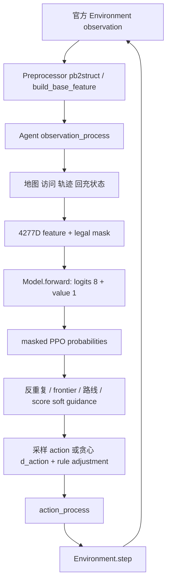

# 项目架构

实际源码保留单个学习机器人的离散动作 Actor-Critic 与规则辅助控制。官方 NPC 是环境对象，不是本工程训练的多智能体。[PPO 网络](ppo.md)、[观测](observation_action.md)、[奖励](reward.md)、[混合决策](hybrid_decision.md)分别说明实现细节。

## 推理数据流

[Agent](../agent_ppo/agent.py)的 `observation_process` 更新显式记忆和 shaping reward；`predict` 提供随机动作和贪心动作；`exploit` 返回规则调整后的贪心动作。没有 RNN，地图记忆由跨步 Python 状态维护，每局 reset。

## 训练数据流

`EpisodeRunner.run_episodes` 将前一状态、实际执行动作、old probability/value 与 `agent.last_reward` 组成样本。`env_reward` 被读取但不是直接训练目标。episode 结束叠加终局 shaping，再调用 `sample_process` 和 `_calc_gae`，通过 `send_sample_data` 交给官方平台。[Algorithm.learn](../agent_ppo/algorithm/algorithm.py)对收到的 batch 做一次梯度更新。

环境通信、BaseAgent 生命周期、样本服务、模型同步、worker 和 learner 调度依赖外部官方 runtime。详见[训练流程](training.md)与[依赖](dependencies.md)。

## 责任边界

| 层 | 可由源码支持的能力 |
|---|---|
| PPO 网络 | 学习状态到动作偏好和 value；不显式执行 BFS |
| 手工辅助 | 已知图 BFS、frontier、反重复、回充/离桩、NPC 预测、卡住处理 |
| 官方环境 | 清扫与耗电规则、补电、合法动作/碰撞、终局与评分 |

当前行为经过软引导与硬规则，不能把所有能力归于 PPO。保存的代码版本标签 `202604282345` 是手写标识，不是 Git 提交时间；当前配置也不是最终提交证明。22 个原始源码/配置的指纹见 [source_manifest.json](../configs/source_manifest.json)。
